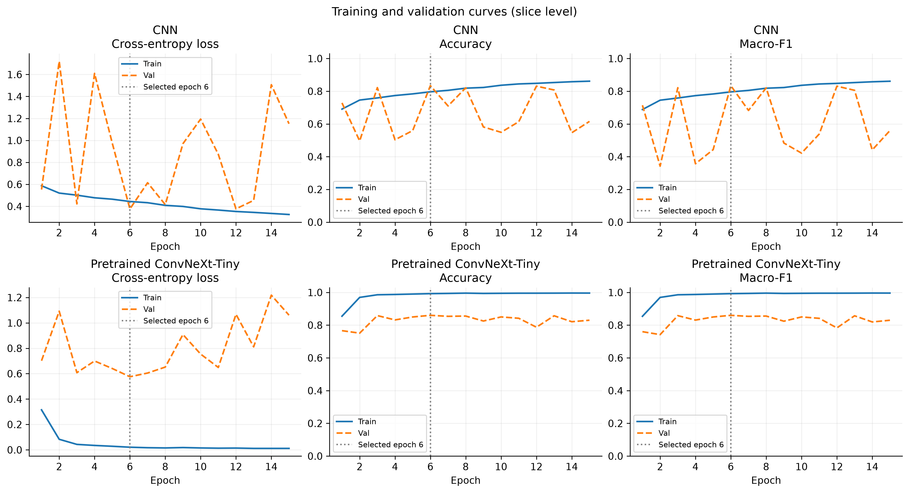
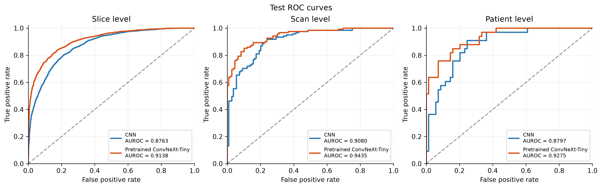
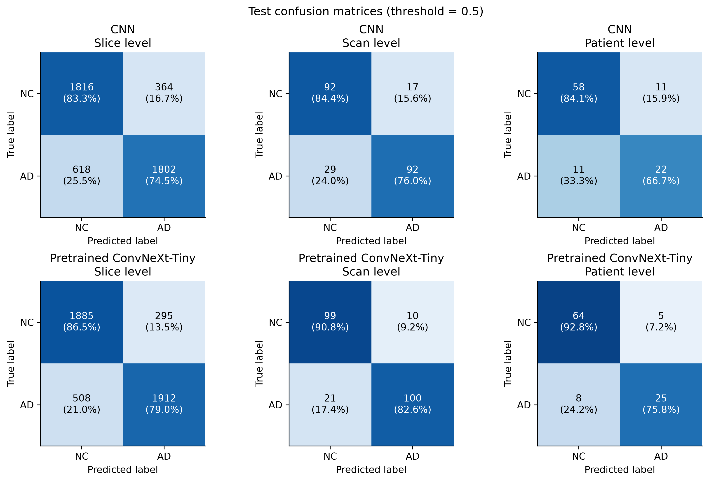
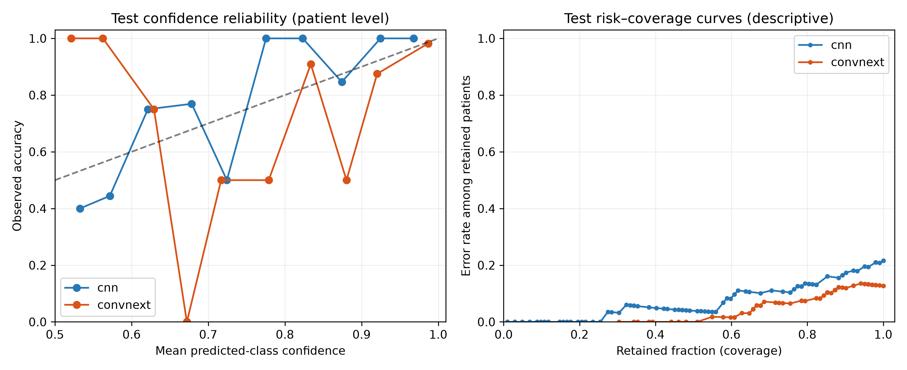

# ADNI MRI Classification with ConvNeXt-Tiny

Yangjia Yan | Student ID: 49840232 | COMP3710

This project compares a small CNN trained from scratch with an
ImageNet-pretrained ConvNeXt-Tiny fine-tuned for binary classification
of Alzheimer's disease (AD) and normal controls (NC).

The experiments adapt ConvNeXt to ADNI MRI slices. They do not reproduce
the original paper's ImageNet experiments.

## Feasibility review

### Scope and acceptance criteria

The project investigates AD versus NC classification from ADNI MRI
slices and whether prediction confidence can identify ambiguous patients
for specialist review. A small CNN trained from scratch is compared
with an ImageNet-pretrained ConvNeXt-Tiny.

The original feasibility review specified five acceptance criteria:

1. Zero patient overlap between training, validation and test splits.
2. ConvNeXt held-out test accuracy of at least 80%.
3. Both models evaluated on the same split using Macro-F1, AUROC,
   AD sensitivity and NC specificity.
4. Analysis of three to five misclassifications and a confidence-based
   human-review rule.
5. Documented GPU memory and inference latency, with experiments
   feasible on one A100 GPU with 40 GB VRAM.

The accuracy target is reported explicitly at slice level in the final
results, alongside scan-level and patient-level evaluation.

### Model choice and preliminary evidence

ConvNeXt-Tiny connects convolutional feature learning, residual learning
and transfer learning with supervised classification. The project applies
the architecture to MRI classification rather than reproducing the
paper's ImageNet experiments. Architecture and pretraining both change
relative to the baseline, limiting causal interpretation.

The initial audit indexed 30,520 slices from 1,526 scans and 680 patients.
Metadata checks found no conflicting patient labels. The patient split
contained 476 training, 102 validation and 102 test patients, with no
patient overlap.

At preparation of the original review, both models had completed
15 epochs. The CNN achieved validation slice Macro-F1 of 0.8339 in
7.1 minutes, and ConvNeXt achieved 0.8600 in 21.1 minutes.
These measurements demonstrated training feasibility on Rangpur.

### Risks, resource plan and fallback

The main risks were patient leakage, unstable CNN validation behaviour,
ConvNeXt overfitting and confident prediction errors. The plan used a
fixed patient manifest, validation-based checkpoint selection and a
held-out test evaluation. GPU profiling and failure analysis were
planned to assess practical limitations beyond classification accuracy.

Experiments used one A100 GPU and four CPU cores per job. Measured
training times supported this resource plan, although scheduler waiting
time remained variable. The smaller CNN provided a fallback if
ConvNeXt proved too costly or unreliable.

The original review was prepared before test evaluation. Subsequent
test, profiling and confidence findings are reported in their own
sections; they are not presented as preliminary review evidence.

### Review outcome and tutor feedback

The feasibility review was completed with a tutor on 23 October 2026.
Feedback requested a model architecture diagram, explicit prerequisites
and training parameter settings in the final report. These are included
in the architecture figure, environment section and training table.

## Environment and prerequisites

Training and evaluation were run on the UQ Rangpur cluster using Slurm,
the `comp3710` partition, one NVIDIA A100-PCIE-40GB GPU and four CPU cores
per job.

| Software | Recorded version |
|---|---|
| Python | 3.11.15 |
| PyTorch | 2.14.0+cu130 |
| PyTorch CUDA build | 13.0 |
| cuDNN | 9.24.0 |
| Torchvision | 0.29.0 |
| NumPy | 2.4.6 |
| Scikit-learn | 1.9.1 |
| Pillow | 12.3.0 |
| Matplotlib | 3.11.1 |

See `results/software_environment.txt` for the recorded environment.
The operating-system information in that file was collected on a login
node; GPU information came from completed training logs.

The commands below assume this project's Rangpur directory and an
existing Conda environment named `torch`:

```bash
cd ~/PatternAnalysis-2026/recognition/ConvNeXt_ADNI_YangjiaYan
source ~/miniconda3/etc/profile.d/conda.sh
conda activate torch
```

Prerequisites:

- Access to the course ADNI dataset and its metadata.
- A CUDA-compatible GPU environment for full training and evaluation.
- Slurm access for the supplied training scripts.
- Access to the Torchvision pretrained weights, or a cached copy, for
  the first pretrained ConvNeXt training run.

Dataset files, trained checkpoints and individual prediction CSVs are
stored outside this repository. Paths below describe the author's
Rangpur setup and must be adjusted on another system.

## Dataset and patient-independent split

Dataset root: `/home/groups/comp3710/ADNI`

The loader reads `meta_data_with_label.json` and JPEG slices under
`AD_NC/{train,test}/{AD,NC}`. It combines the provided folders and creates
a new patient-stratified split using seed 42. The original folder
assignment is retained as `original_split` in the manifest.

Labels are NC = 0 and AD = 1.

| Split | Patients | Slices |
|---|---:|---:|
| Train | 476 | 21,640 |
| Validation | 102 | 4,280 |
| Test | 102 | 4,600 |
| Total | 680 | 30,520 |

The data contain 1,526 scans. All slices and scans from a patient remain
in the same split. The split audit found no patient overlap or
conflicting patient labels.

Generate and audit the manifest:

```bash
python dataset.py \
  --root /home/groups/comp3710/ADNI \
  --manifest ~/data/comp3710_a3_adni_split.csv \
  --seed 42
```

Reuse the same manifest for all model comparisons.

## Preprocessing

Images are converted to RGB and resized to 224 × 224 pixels.
Training additionally uses random rotation within ±5 degrees.
All splits use tensor conversion and ImageNet normalisation:

- Mean: [0.485, 0.456, 0.406]
- Standard deviation: [0.229, 0.224, 0.225]

Validation and test transforms contain no random augmentation.

## How the models work

### CNN baseline

The baseline learns spatial filters using four convolutional layers
with 32, 64, 128 and 256 output channels. Each convolution uses a
3 x 3 kernel, followed by batch normalisation and ReLU. Shared filter
weights allow the model to detect patterns at different image positions.

The first three blocks use max pooling to reduce spatial resolution
from 224 to 112, 56 and 28 pixels. The final block uses adaptive average
pooling to produce one value per channel. A two-layer classifier maps
the resulting 256 features to NC and AD logits. Dropout with probability
0.3 provides regularisation during training.

This model is trained from random initialisation. It provides an
implemented baseline for testing whether the larger pretrained model
offers a useful improvement on the same patient split.

### ConvNeXt-Tiny

ConvNeXt is a convolutional architecture developed by modernising
ResNet-style design using choices also found in hierarchical vision
Transformers [1]. It remains a convolutional network.

A 4 x 4 convolution with stride 4 forms the input stem. Four stages
contain 3, 3, 9 and 3 residual blocks, with channel widths of 96, 192,
384 and 768. Downsampling reduces spatial resolution between stages.

Within each block, a 7 x 7 depthwise convolution processes spatial
information separately in each channel. Layer normalisation is followed
by linear layers that expand the channel dimension fourfold and project
it back, with GELU between them. These layers mix information across
channels. Layer scaling, stochastic depth and residual addition complete
the block [2].

Residual connections preserve a direct path for features and gradients
through the network. Global average pooling and the final classifier
produce two class logits. In this project, the original output layer
is replaced by a linear layer with two outputs.

### Transfer learning and MRI input

ConvNeXt starts from ImageNet-pretrained weights, then all parameters
are fine-tuned on the ADNI training split. Pretraining supplies an
initial representation rather than fixed MRI-specific knowledge.

Each grayscale MRI slice is converted to three identical RGB channels
to match the pretrained model's input. This does not add colour or
three-dimensional information. ImageNet normalisation maintains the
input convention used for pretraining. Applying the same preprocessing
to the baseline keeps the input pipeline consistent.

### Learning objective and decision rule

For logits z_NC and z_AD, softmax gives:

$$
P(AD \mid x) =
\frac{\exp(z_{AD})}{\exp(z_{NC})+\exp(z_{AD})}.
$$

Cross-entropy penalises low probability assigned to the true class:

$$
L = -\frac{1}{N}\sum_{i=1}^{N}\log p_{i,y_i}.
$$

AdamW updates the trainable parameters using gradients of this loss,
with weight decay for regularisation. The final classification rule
predicts AD when P(AD) is at least 0.5. Scan and patient probabilities
are subsequently calculated using the fixed aggregation rule described
in the evaluation section.

## Models and training


| Setting | SimpleCNN | ConvNeXt-Tiny |
|---|---|---|
| Initialisation | Random | ImageNet pretrained |
| Trainable parameters | 422,530 | 27,821,666 |
| Optimiser | AdamW | AdamW |
| Learning rate | 0.0001 | 0.0001 |
| Weight decay | 0.01 | 0.01 |
| Loss | Cross-entropy | Cross-entropy |
| Batch size | 64 | 32 |
| Epochs | 15 | 15 |
| DataLoader workers | 4 | 4 |
| Seed | 42 | 42 |
| Selected epoch | 6 | 6 |
| Training time (seconds) | 426.59 | 1,263.56 |

All parameters were trainable. ConvNeXt uses
`ConvNeXt_Tiny_Weights.DEFAULT`, with its final linear layer replaced
by a two-class output layer.

Both runs completed 15 epochs. Checkpoints were selected using the
highest validation slice-level Macro-F1, rather than the last epoch.
No early stopping was used.

Submit the final training configurations:

```bash
sbatch train_cnn_lr1e4.slurm
sbatch train_convnext.slurm
```

The earlier CNN run at learning rate 0.001 is retained as a development
experiment. The final CNN baseline uses learning rate 0.0001.

## Evaluation

Run the following commands inside an allocated GPU job, after activating
the environment and entering the project directory.

```bash
python -u evaluate.py \
  --checkpoint ~/data/comp3710_a3_runs_lr1e4/cnn/full/best_model.pth \
  --split val \
  --output-dir ~/data/comp3710_a3_evaluation/cnn/val

python -u evaluate.py \
  --checkpoint ~/data/comp3710_a3_runs_pretrained/convnext/full/best_model.pth \
  --split val \
  --output-dir ~/data/comp3710_a3_evaluation/convnext/val
```

Validation evaluation reproduced the saved checkpoint metrics for both
models. After model selection, the checkpoints, threshold and aggregation
rule were fixed before test evaluation:

```bash
python -u evaluate.py \
  --checkpoint ~/data/comp3710_a3_runs_lr1e4/cnn/full/best_model.pth \
  --split test \
  --output-dir ~/data/comp3710_a3_evaluation/cnn/test

python -u evaluate.py \
  --checkpoint ~/data/comp3710_a3_runs_pretrained/convnext/full/best_model.pth \
  --split test \
  --output-dir ~/data/comp3710_a3_evaluation/convnext/test
```

Predictions use P(AD) ≥ 0.5 for AD. Scan probabilities are the mean of
slice probabilities within each scan. Patient probabilities are the
mean of scan probabilities, giving equal weight to each scan within
a patient.

The evaluator saves metrics and predictions at slice, scan and patient
levels. Confusion matrices use true labels as rows and predicted labels
as columns, ordered [NC, AD].

## Test results

| Level | Model | Accuracy | Macro-F1 | AUROC |
|---|---|---:|---:|---:|
| Slice | CNN | 0.7865 | 0.7865 | 0.8763 |
| Slice | ConvNeXt-Tiny | 0.8254 | 0.8254 | 0.9138 |
| Scan | CNN | 0.8000 | 0.8000 | 0.9080 |
| Scan | ConvNeXt-Tiny | 0.8652 | 0.8652 | 0.9435 |
| Patient | CNN | 0.7843 | 0.7536 | 0.8797 |
| Patient | ConvNeXt-Tiny | 0.8725 | 0.8507 | 0.9275 |

At patient level, ConvNeXt correctly classified 89 of 102 patients.
AD sensitivity was 0.7576 (25/33), and NC specificity was 0.9275 (64/69).
There were eight false negatives and five false positives.

Full validation and test metrics are in `results/metrics_summary.csv`.

## Training behaviour and test interpretation



The CNN's training accuracy increased throughout training, but validation
loss and Macro-F1 fluctuated substantially. Reducing the learning rate
from 0.001 to 0.0001 improved the best validation slice Macro-F1 from
0.8097 to 0.8339. This supports the final learning-rate choice, but does
not establish the cause of the remaining instability.

ConvNeXt reached approximately 99.6% training accuracy by epoch 15,
while validation accuracy remained between approximately 75% and 86%.
This generalisation gap suggests overfitting. Both final checkpoints
came from epoch 6, selected by validation slice Macro-F1.



ConvNeXt achieved higher test AUROC than the CNN at slice, scan and
patient levels. Aggregation produced higher observed accuracy than
individual slice classification for ConvNeXt. However, slices, scans
and patients are different evaluation units with different class
distributions; these comparisons do not isolate aggregation as a
causal source of improvement.



At patient level, the test set contained 69 NC patients and 33 AD
patients. Predicting NC for every patient would achieve 67.65% accuracy,
which illustrates why accuracy alone is insufficient.

The CNN missed 11 of 33 AD patients and incorrectly classified 11 of
69 NC patients as AD. ConvNeXt reduced these counts to eight missed AD
patients and five incorrectly flagged NC patients. Its AD sensitivity
of 75.76% remained lower than its NC specificity of 92.75%.

Patient-level Macro-F1 and class-specific results therefore provide
information that overall accuracy can conceal. The remaining false
negatives are a practical concern for any proposed screening use.

## GPU inference resource comparison

Both models were profiled on an NVIDIA A100-PCIE-40GB using a single
validation slice with shape (1, 3, 224, 224), float32 precision,
20 warm-up iterations and 100 timed iterations. TF32 and cuDNN
benchmarking were disabled.

| Measurement | SimpleCNN | ConvNeXt-Tiny |
|---|---:|---:|
| Parameters | 422,530 | 27,821,666 |
| Mean latency (ms) | 0.659 | 4.266 |
| Median latency (ms) | 0.666 | 4.259 |
| 95th-percentile latency (ms) | 0.680 | 4.336 |
| Peak allocated GPU memory (MiB) | 22.57 | 128.90 |
| Peak reserved GPU memory (MiB) | 44.00 | 150.00 |

Timing covers GPU forward inference and softmax. It excludes image
loading, preprocessing and CPU-to-GPU transfer, so it is not an
end-to-end patient processing time. Allocated memory includes the model,
input and temporary tensors; reserved memory also includes the PyTorch
allocator cache. These are inference measurements, not training peaks.

ConvNeXt improved patient-level test accuracy by 8.82 percentage points,
while requiring approximately 6.47 times the mean GPU inference latency
and 5.71 times the peak allocated memory. The CNN therefore provides a
lower-cost baseline, while ConvNeXt offers better predictive performance
under the tested conditions.

Recorded profiles are in `results/resource_profiles/`.

## Prediction confidence and referral analysis

Patient confidence was defined as max(P(AD), 1 - P(AD)), using the
aggregated patient probability. Confidence describes the model's output;
it is not a verified probability that an individual prediction is correct.

| Test measurement | CNN | ConvNeXt-Tiny |
|---|---:|---:|
| Brier score, lower is better | 0.1347 | 0.1036 |
| Confidence ECE, 10 bins | 0.1194 | 0.0917 |
| Mean confidence of correct predictions | 0.7991 | 0.9072 |
| Mean confidence of incorrect predictions | 0.6384 | 0.7903 |
| Predictions with confidence at least 0.90 | 22 | 64 |
| Errors among those predictions | 0 | 2 |

ConvNeXt had better overall Brier score and confidence ECE, but some
errors remained highly confident. Its higher confidence on incorrect
predictions shows why confidence alone cannot guarantee correctness.
ECE is an empirical summary based on 102 patients and depends on binning.

### Validation-selected referral rule

Low-confidence patients were flagged for human review. Candidate
confidence thresholds ranged from 0.50 to 1.00 in steps of 0.01.
The rule retained as many validation patients as possible while requiring
at least 20 retained patients and an empirical retained error rate of
at most 5%. The classification threshold remained fixed at P(AD) = 0.5.

| Test outcome | CNN | ConvNeXt-Tiny |
|---|---:|---:|
| Validation-selected confidence threshold | 0.77 | 0.82 |
| Retained patients | 53/102 | 80/102 |
| Coverage | 51.96% | 78.43% |
| Patients referred for review | 49 | 22 |
| Accuracy among retained patients | 96.23% | 92.50% |
| Errors among retained patients | 2 | 6 |
| Retained false negatives | 1 | 4 |
| Retained false positives | 1 | 2 |
| Errors flagged for review | 20/22 | 7/13 |

ConvNeXt retained more patients and required fewer reviews, but its
retained test error rate was 7.5%, exceeding the 5% validation target.
The CNN retained fewer patients and achieved a 3.77% retained error rate.
The retained accuracies describe different subsets and coverage levels,
so they cannot be treated as an equal-coverage comparison.

Referral flags do not mean that errors were corrected. Human review
outcomes, review time and downstream clinical benefit were not measured.

This was an exploratory extension performed after the initial test
results had been inspected. The script selected thresholds using
validation data, then applied them unchanged to test predictions.
The findings require independent confirmation and should not be
described as a prospectively validated deployment policy.



Detailed results are in `results/confidence/`.

## Figures

```bash
OPENBLAS_NUM_THREADS=1 OMP_NUM_THREADS=1 python plot_results.py
OPENBLAS_NUM_THREADS=1 OMP_NUM_THREADS=1 python plot_architecture.py
```

`plot_results.py` reads the saved training histories and prediction CSVs.
It writes figures to `~/data/comp3710_a3_figures/`.
`plot_architecture.py` writes to `results/figures/`.

The repository includes training curves, test ROC curves, confusion
matrices and the model architecture overview. Error-case images remain
outside the repository.

Error cases were selected as the three most confident ConvNeXt
patient-level false negatives and two most confident false positives.
Each displayed MRI is one illustrative slice; the reported score is
aggregated across the patient's scans.

## Failure-case analysis

Five patients were selected from ConvNeXt's test errors: the three
most confident false negatives and two most confident false positives.
The probabilities below are patient-level P(AD), rounded to three
decimal places. Predictions use a threshold of 0.5.

| Case | True label | ConvNeXt P(AD) | ConvNeXt prediction | CNN P(AD) | CNN prediction |
|---|---|---:|---|---:|---|
| 1 | AD | 0.047 | NC | 0.471 | NC |
| 2 | AD | 0.096 | NC | 0.601 | AD |
| 3 | AD | 0.126 | NC | 0.463 | NC |
| 4 | NC | 0.895 | AD | 0.875 | AD |
| 5 | NC | 0.830 | AD | 0.456 | NC |

### Case 1: both models missed AD

Both models predicted NC. The CNN probability was close to 0.5,
but ConvNeXt strongly favoured NC. ConvNeXt's high confidence did
not make this prediction reliable. Checking agreement between the
two models would also fail to identify this error.

### Case 2: the baseline was correct

The CNN correctly predicted AD, while ConvNeXt predicted NC with
90.4% confidence. A model with better overall results can still
perform worse on an individual patient. Model disagreement could
be investigated as an additional review signal.

### Case 3: another confident false negative

ConvNeXt assigned only 0.126 probability to AD. Its confidence in
the incorrect NC prediction was 87.4%, above the 82% retention
threshold. This patient would therefore remain outside the review
group. A confidence rule can miss precisely the errors that need
attention.

### Case 4: both models incorrectly predicted AD

Both models gave high AD probabilities to an NC patient. This
shows another limit of using model agreement as a reliability check.
The next step would be to inspect image quality, acquisition details
and predictions across the patient's scans. The current results
do not establish which feature caused the shared error.

### Case 5: a false positive retained by the confidence rule

ConvNeXt predicted AD with probability 0.830, while the CNN correctly
predicted NC. This ConvNeXt error would also pass the 0.82 confidence
threshold. The illustrative slice appeared darker than several other
examples, but this alone does not show that intensity caused the error.
An intensity audit would be needed before changing preprocessing.

These cases were selected for confident errors and are not a
representative sample of the test set. The locally generated
failure-case figure shows one illustrative slice per patient,
while each patient prediction uses multiple slices and scans.
The anatomical causes of the errors were not established.

## Practical recommendation

ConvNeXt is the better candidate for further work in this experiment.
It correctly classified 89 of 102 test patients, compared with 80
for the CNN, but used more GPU memory and took longer per slice.

The confidence rule reduced the number of patients flagged for review
to 22 of 102. It captured seven of ConvNeXt's 13 errors, but six
errors remained among the retained predictions, including four
missed AD patients. This is not sufficient evidence for using the
model to rule out AD without review.

Before using this approach in practice, the review rule should be
tested on an independent cohort. That study should also measure
review time, reviewer decisions and performance across acquisition
conditions. The CNN remains a useful low-cost baseline.

## Limitations

Results come from one patient split and one training seed per final
configuration. This comparison changes architecture, pretraining and
batch size, so it does not isolate the effect of architecture alone.

ConvNeXt fitted the training set closely, while validation performance
remained lower. CNN validation metrics fluctuated substantially.
The causes of these fluctuations were not established.

Patient-level test evaluation contains 102 patients, including 33 AD
patients. No external dataset validation was performed. Selected error
examples do not establish the frequency or anatomical cause of a
failure pattern.

## Artificial Intelligence Usage Disclosure

I used OpenAI ChatGPT throughout the project for technical explanations,
implementation assistance, troubleshooting and report preparation.
Its contribution included substantial code drafts and suggested
revisions, rather than language editing alone.

AI assistance covered:

- Dataset indexing, patient-independent splitting and leakage checks.
- The CNN baseline, integration of Torchvision ConvNeXt, training,
  checkpoint evaluation and prediction scripts.
- Slurm configuration and interpretation of scheduling and runtime logs.
- Plotting, inference profiling, confidence analysis and referral rules.
- Drafting and revising README explanations, tables and discussion.

I executed the commands and experiments on the UQ Rangpur cluster and
provided the resulting logs and metrics for inspection. Numerical
results reported here came from those executed experiments and saved
outputs, rather than AI-generated estimates.

Verification included patient split and label checks, model parameter
counts, reproduction of saved validation metrics, inspection of test
confusion matrices, and recorded GPU profiling measurements. Validation
evaluation reproduced both selected checkpoints' saved metrics within
the evaluator's numerical tolerance.

The workflow also identified limitations requiring correction or
qualification. An early smoke-test subset contained only one class
and was subsequently balanced. Batch-normalisation recalibration was
treated as a diagnostic and did not modify the final checkpoint.
The confidence-referral analysis is explicitly labelled exploratory
because it was developed after initial test results were available.

AI suggestions and explanations were checked against available code,
execution outputs and cited sources. These checks do not establish
that every implementation detail is error-free. I remain responsible
for the submitted code, interpretation and disclosure of limitations.

## References

[1] Liu, Z., Mao, H., Wu, C.-Y., Feichtenhofer, C., Darrell, T.,
and Xie, S. (2022). *A ConvNet for the 2020s*. CVPR, 11976–11986.
https://openaccess.thecvf.com/content/CVPR2022/html/Liu_A_ConvNet_for_the_2020s_CVPR_2022_paper.html

[2] PyTorch contributors. *Torchvision ConvNeXt implementation*.
The project uses Torchvision's implementation and pretrained weights.
https://github.com/pytorch/vision/blob/main/torchvision/models/convnext.py
