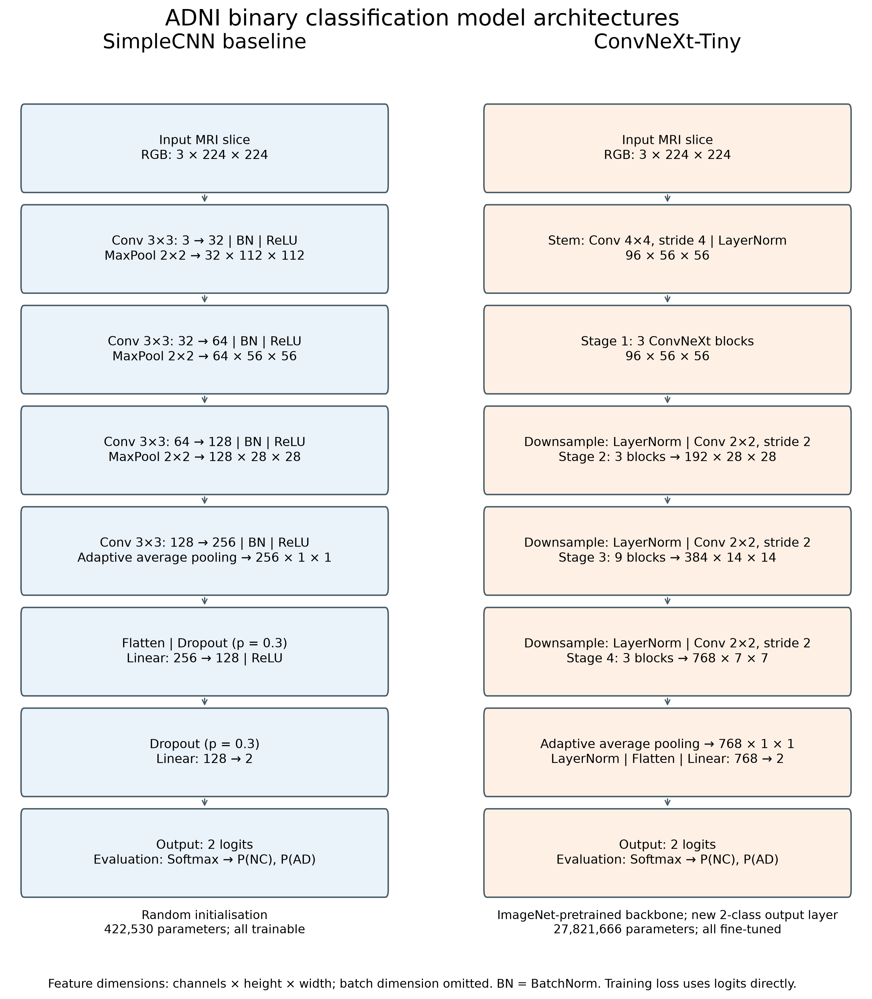

# ADNI MRI Classification with ConvNeXt-Tiny

Yangjia Yan | Student ID: 4984023 | COMP3710

This project compares a small CNN trained from scratch with an
ImageNet-pretrained ConvNeXt-Tiny fine-tuned for binary classification
of Alzheimer's disease (AD) and normal controls (NC).

The experiments adapt ConvNeXt to ADNI MRI slices. They do not reproduce
the original paper's ImageNet experiments.

## Environment and prerequisites

Training and evaluation were run on the UQ Rangpur cluster using Slurm,
the `comp3710` partition, one NVIDIA A100-PCIE-40GB GPU and four CPU cores
per job.

| Software | Recorded version |
|---|---|
| Python | 3.11.15 |
| PyTorch | 2.14.0+cu130 |
| PyTorch CUDA build | 13.0 |
| cuDNN | 9.24.0 |
| Torchvision | 0.29.0 |
| NumPy | 2.4.6 |
| Scikit-learn | 1.9.1 |
| Pillow | 12.3.0 |
| Matplotlib | 3.11.1 |

See `results/software_environment.txt` for the recorded environment.
The operating-system information in that file was collected on a login
node; GPU information came from completed training logs.

The commands below assume this project's Rangpur directory and an
existing Conda environment named `torch`:

```bash
cd ~/PatternAnalysis-2026/recognition/ConvNeXt_ADNI_YangjiaYan
source ~/miniconda3/etc/profile.d/conda.sh
conda activate torch
```

Prerequisites:

- Access to the course ADNI dataset and its metadata.
- A CUDA-compatible GPU environment for full training and evaluation.
- Slurm access for the supplied training scripts.
- Access to the Torchvision pretrained weights, or a cached copy, for
  the first pretrained ConvNeXt training run.

Dataset files, trained checkpoints and individual prediction CSVs are
stored outside this repository. Paths below describe the author's
Rangpur setup and must be adjusted on another system.

## Dataset and patient-independent split

Dataset root: `/home/groups/comp3710/ADNI`

The loader reads `meta_data_with_label.json` and JPEG slices under
`AD_NC/{train,test}/{AD,NC}`. It combines the provided folders and creates
a new patient-stratified split using seed 42. The original folder
assignment is retained as `original_split` in the manifest.

Labels are NC = 0 and AD = 1.

| Split | Patients | Slices |
|---|---:|---:|
| Train | 476 | 21,640 |
| Validation | 102 | 4,280 |
| Test | 102 | 4,600 |
| Total | 680 | 30,520 |

The data contain 1,526 scans. All slices and scans from a patient remain
in the same split. The split audit found no patient overlap or
conflicting patient labels.

Generate and audit the manifest:

```bash
python dataset.py \
  --root /home/groups/comp3710/ADNI \
  --manifest ~/data/comp3710_a3_adni_split.csv \
  --seed 42
```

Reuse the same manifest for all model comparisons.

## Preprocessing

Images are converted to RGB and resized to 224 × 224 pixels.
Training additionally uses random rotation within ±5 degrees.
All splits use tensor conversion and ImageNet normalisation:

- Mean: [0.485, 0.456, 0.406]
- Standard deviation: [0.229, 0.224, 0.225]

Validation and test transforms contain no random augmentation.

## Models and training



| Setting | SimpleCNN | ConvNeXt-Tiny |
|---|---|---|
| Initialisation | Random | ImageNet pretrained |
| Trainable parameters | 422,530 | 27,821,666 |
| Optimiser | AdamW | AdamW |
| Learning rate | 0.0001 | 0.0001 |
| Weight decay | 0.01 | 0.01 |
| Loss | Cross-entropy | Cross-entropy |
| Batch size | 64 | 32 |
| Epochs | 15 | 15 |
| DataLoader workers | 4 | 4 |
| Seed | 42 | 42 |
| Selected epoch | 6 | 6 |
| Training time (seconds) | 426.59 | 1,263.56 |

All parameters were trainable. ConvNeXt uses
`ConvNeXt_Tiny_Weights.DEFAULT`, with its final linear layer replaced
by a two-class output layer.

Both runs completed 15 epochs. Checkpoints were selected using the
highest validation slice-level Macro-F1, rather than the last epoch.
No early stopping was used.

Submit the final training configurations:

```bash
sbatch train_cnn_lr1e4.slurm
sbatch train_convnext.slurm
```

The earlier CNN run at learning rate 0.001 is retained as a development
experiment. The final CNN baseline uses learning rate 0.0001.

## Evaluation

Run the following commands inside an allocated GPU job, after activating
the environment and entering the project directory.

```bash
python -u evaluate.py \
  --checkpoint ~/data/comp3710_a3_runs_lr1e4/cnn/full/best_model.pth \
  --split val \
  --output-dir ~/data/comp3710_a3_evaluation/cnn/val

python -u evaluate.py \
  --checkpoint ~/data/comp3710_a3_runs_pretrained/convnext/full/best_model.pth \
  --split val \
  --output-dir ~/data/comp3710_a3_evaluation/convnext/val
```

Validation evaluation reproduced the saved checkpoint metrics for both
models. After model selection, the checkpoints, threshold and aggregation
rule were fixed before test evaluation:

```bash
python -u evaluate.py \
  --checkpoint ~/data/comp3710_a3_runs_lr1e4/cnn/full/best_model.pth \
  --split test \
  --output-dir ~/data/comp3710_a3_evaluation/cnn/test

python -u evaluate.py \
  --checkpoint ~/data/comp3710_a3_runs_pretrained/convnext/full/best_model.pth \
  --split test \
  --output-dir ~/data/comp3710_a3_evaluation/convnext/test
```

Predictions use P(AD) ≥ 0.5 for AD. Scan probabilities are the mean of
slice probabilities within each scan. Patient probabilities are the
mean of scan probabilities, giving equal weight to each scan within
a patient.

The evaluator saves metrics and predictions at slice, scan and patient
levels. Confusion matrices use true labels as rows and predicted labels
as columns, ordered [NC, AD].

## Test results

| Level | Model | Accuracy | Macro-F1 | AUROC |
|---|---|---:|---:|---:|
| Slice | CNN | 0.7865 | 0.7865 | 0.8763 |
| Slice | ConvNeXt-Tiny | 0.8254 | 0.8254 | 0.9138 |
| Scan | CNN | 0.8000 | 0.8000 | 0.9080 |
| Scan | ConvNeXt-Tiny | 0.8652 | 0.8652 | 0.9435 |
| Patient | CNN | 0.7843 | 0.7536 | 0.8797 |
| Patient | ConvNeXt-Tiny | 0.8725 | 0.8507 | 0.9275 |

At patient level, ConvNeXt correctly classified 89 of 102 patients.
AD sensitivity was 0.7576 (25/33), and NC specificity was 0.9275 (64/69).
There were eight false negatives and five false positives.

Full validation and test metrics are in `results/metrics_summary.csv`.

## Figures

```bash
OPENBLAS_NUM_THREADS=1 OMP_NUM_THREADS=1 python plot_results.py
OPENBLAS_NUM_THREADS=1 OMP_NUM_THREADS=1 python plot_architecture.py
```

`plot_results.py` reads the saved training histories and prediction CSVs.
It writes figures to `~/data/comp3710_a3_figures/`.
`plot_architecture.py` writes to `results/figures/`.

The repository includes training curves, test ROC curves, confusion
matrices and the model architecture overview. Error-case images remain
outside the repository.

Error cases were selected as the three most confident ConvNeXt
patient-level false negatives and two most confident false positives.
Each displayed MRI is one illustrative slice; the reported score is
aggregated across the patient's scans.

## Limitations

Results come from one patient split and one training seed per final
configuration. This comparison changes architecture, pretraining and
batch size, so it does not isolate the effect of architecture alone.

ConvNeXt fitted the training set closely, while validation performance
remained lower. CNN validation metrics fluctuated substantially.
The causes of these fluctuations were not established.

Patient-level test evaluation contains 102 patients, including 33 AD
patients. No external dataset validation was performed. Selected error
examples do not establish the frequency or anatomical cause of a
failure pattern.

## Reference

Liu et al. (2022). *A ConvNet for the 2020s*. CVPR.
